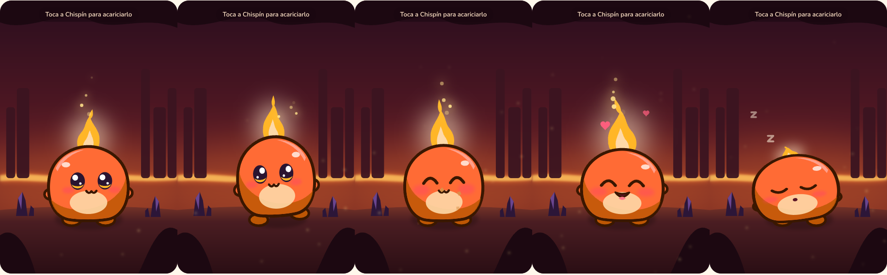

# Tam Tam Evo

Juego móvil de crianza, evolución y combate automático de criaturas 2D ilustradas.

**Estado:** prototipo jugable del primer Tamtam (vertical slice). Ver [FIRST_TAMTAM_VERTICAL_SLICE](docs/FIRST_TAMTAM_VERTICAL_SLICE.md) y el vídeo `docs/media/vertical-slice-demo.mp4`.



## Ejecutar
Requisitos: Node 22+ y pnpm 10 (`corepack enable`).

```bash
pnpm install
```

```bash
pnpm --filter mobile start
```

Escanea el QR con **Expo Go** (Android/iOS) para jugar el prototipo en tu teléfono (botón DEV = modo debug). Para la versión web: `pnpm --filter mobile web:build` y, después, `node tools/screenshots.mjs` genera capturas de QA.

```bash
pnpm test
```

```bash
pnpm typecheck
```

## Estructura
| Ruta | Contenido |
|------|-----------|
| `apps/mobile` | App Expo (React Native + Skia + Reanimated) |
| `packages/rig` | TamRig: runtime de animación 2D (TS puro, worklets) |
| `packages/art` | Criaturas: rigs, partes vectoriales, clips y alelos de color |
| `tools/` | Scripts de QA |
| `docs/` | Documentación de diseño |

## Documentación
| Documento | Contenido |
|-----------|-----------|
| [GAME_DESIGN_DOCUMENT](docs/GAME_DESIGN_DOCUMENT.md) | Visión, bucles y estructura. **Decisiones pendientes (§13)** |
| [CREATURE_DATABASE](docs/CREATURE_DATABASE.md) | 8 familias, 40 formas, habilidades y stats |
| [EVOLUTION_SYSTEM](docs/EVOLUTION_SYSTEM.md) | Fórmula de evolución, genética, cría y Códice |
| [GAMEPLAY_SYSTEMS](docs/GAMEPLAY_SYSTEMS.md) | Cuidados, hábitat, minijuegos, Arena y economía |
| [TECHNICAL_ARCHITECTURE](docs/TECHNICAL_ARCHITECTURE.md) | Stack, arquitectura, persistencia, pruebas y backend |
| [ART_DIRECTION](docs/ART_DIRECTION.md) | Estilo, color, tipografía y animación |
| [ROADMAP](docs/ROADMAP.md) | Fases, criterios de aceptación y estado |
| [CHANGELOG](docs/CHANGELOG.md) | Historial de cambios |
| [ART_BIBLE](docs/ART_BIBLE.md) | Biblia artística de personajes |
| [CHARACTER_DESIGN_FIRST_TAMTAM](docs/CHARACTER_DESIGN_FIRST_TAMTAM.md) | Brasálidos: 4 fases y ramas |
| [GAMEPLAY_TEST_RESULTS](docs/GAMEPLAY_TEST_RESULTS.md) | Resultados de QA |
| [PROGRESSION_TIMELINE](docs/PROGRESSION_TIMELINE.md) | Tiempos de crecimiento simulados |
