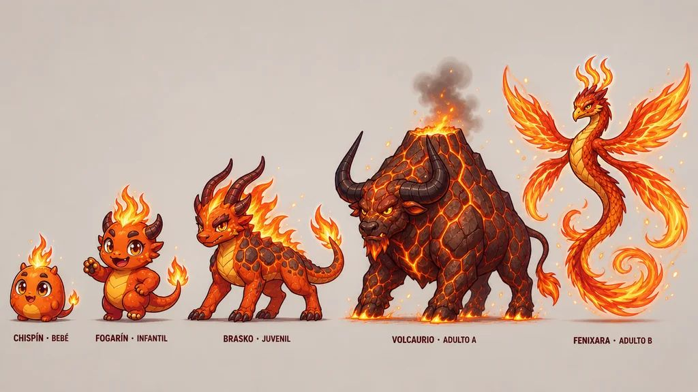

# PRIMER TAMTAM — BRASÁLIDOS (Fuego)

> Versión 1.0 · 2026-11-19 · Estado: diseño **pendiente de aprobación**; forma Bebé implementada en el vertical slice.
> Concepto: `docs/media/concept/fire-family-lineup.jpg` y `docs/media/concept/chispin-sheet.jpg` (generados con IA a partir de ART_BIBLE; **referencias, no assets**).



## 1. Por qué Fuego
1. Es tu preferencia y una de las 3 familias iniciales del FTUE.
2. **Prueba el máximo de sistemas técnicos a la vez:** una llama procedural (follow-through + flicker), emisivos y glow, partículas (ascuas, humo, chispas), recoloreado genético (la llama cambia con el alelo, p. ej. Azul Llama) y el mayor salto anatómico (bolita → toro-volcán o serpiente-ave).
3. Las dos ramas adultas usan arquetipos de rig opuestos (`quadruped_heavy` frente a `serpentine`), lo que obliga a que la plantilla de criatura sea realmente genérica.

## 2. Especie
- **Familia:** Brasálidos · **Afinidad:** Fuego (fuerte contra Naturaleza, débil contra Agua).
- **Historia:** nacieron en la Isla Fragua, bajo un volcán dormido que late con el Tam-Tam. Los antiguos Cuidadores los usaban para mantener viva la hoguera comunal en los inviernos largos.
- **Personalidad:** impulsivos, cariñosos, glotones y un poco celosos; se enfadan rápido y se les pasa enseguida. Les encanta ser el centro de atención.
- **Comportamiento en casa:** buscan las fuentes de calor (brasero, lámpara), odian la comida fría, el baño les gusta solo si tienen mucho Cariño, y se duermen hechos una bola.
- **Necesidades especiales:** el Hambre decae un 20% más rápido (pendiente de aplicar en el slice: hoy usa los valores base).
- **Rasgos ancla (ART_BIBLE §3.3):** ojos ámbar · llama de tres lenguas · ascua en la punta de la cola.

## 3. Las cuatro fases (+ 2 adultos y 1 secreto)

| Fase | Forma | Arquetipo | Altura relativa | Cambios anatómicos | Estado |
|------|-------|-----------|-----------------|--------------------|--------|
| Bebé | **Chispín** | `blob` | 1,0 | Bolita con cabeza y cuerpo en una sola masa, ojos al 34%, llama única, 2 cuernitos de brasa, muñones, cola corta con ascua | ✅ Rig v2, 11 clips |
| Infantil | **Fogarín** | `biped_small` | 1,35 | Bípedo regordete; brazos con 3 dedos; cresta de **3 lenguas**; cuernos curvos; colmillos; cola media con llama | Concepto |
| Juvenil | **Brasko** | `quadruped_light` | 1,8 | Cuadrúpedo ágil; lomo de roca con **grietas de magma** emisivas; melena de llamas por la columna; cuernos largos | Concepto |
| Adulto A | **Volcaurio** | `quadruped_heavy` | 3,0 | Toro colosal con un **cono volcánico humeante** en el lomo; cuernos de obsidiana; piel de basalto con magma pulsante; pezuñas que dejan brasas | Concepto |
| Adulto B | **Fenixara** | `serpentine` + `floater` | 3,2 | Serpiente-ave flotante con **cuatro alas de cinta de fuego** y cola de plumas en espiral; cresta elegante | Concepto |
| Adulto S (temporada) | **Brasaluz** | `flyer` | 3,0 | Ave-dragón de fuego blanco con halo; llamas doradas | Solo reglas |

> Nota de revisión: el concepto de Fenixara se acerca a la iconografía genérica del "fénix". En el redibujo vectorial se reforzará lo que la hace única (cuerpo de serpiente sin patas, alas de **cinta** y no de plumas, cola en espiral) para evitar el cliché.

### Paleta (alelo dominante Brasa)
Base `#FF6B35` · Luz `#FF9566` · Sombra `#D9461B` · Acento (llama, iris) `#FFB627` · Emisivo `#FFE08A` · Tinta `#5A1426` · Vientre `#FFE3A8`.
Alelos: Brasa (D), Ceniza (I), Oro Fundido (I), Rubí Profundo (R) y Azul Llama (R, con llama cian). Todos implementados y probados en contraste.

## 4. Habilidades (CREATURE_DATABASE §1)
Mordisco Ardiente (básico) → Lluvia de Ascuas (Infantil) → Berrinche (Juvenil) → Volcaurio: Erupción + Piel de Magma · Fenixara: Danza Fénix + Renacer de Ceniza.

## 5. Ramas evolutivas y condiciones exactas (implementadas en `packages/core/src/evolution/engine.ts`)

**Transiciones lineales:** Chispín → Fogarín → Brasko. Siempre ocurren al alcanzar la Madurez (17 y 67 acumulados; EVOLUTION_SYSTEM §2.1). Solo las bloquea el estado Abatido.

**Brasko → adulto:**
```
S(c) = 100·Σ w·p (ejes)  + careW·20·(CQ−50)/50  + genética  + catalizador(25)  + 10·Σ u·(atributo/20)
```

| Factor (del brief) | Volcaurio (A) | Fenixara (B) | Brasaluz (S) |
|--------------------|---------------|--------------|--------------|
| **Cuidados** (careW) | 0,3 | 0,5 → favorecida por el buen cuidado | Gate: CQ ≥ 75 |
| **Nivel** | No decide (D10: el tiempo lo marca la Madurez) | No decide | No decide |
| **Fuerza** (atributo) | u = 1,0 | — | — |
| **Inteligencia** (atributo) | — | — | Gate: INT ≥ 8 |
| **Creatividad** (atributo) | — | u = 1,0 | Gate: CRE ≥ 12 |
| **Actividades** (ejes FUE, AGI, ING, VÍN, SER) | 1,0 / 0,1 / 0,2 / 0,3 / 0,6 (Gym, rutina, Arena) | 0,3 / 1,0 / 0,2 / 0,6 / 0,1 (juego, minijuegos, mimos) | — |
| **Genética** | Temperamento SS +12 · potencial clave ≥ 24: +6 | EE +12 · potencial ≥ 24: +6 | — |
| **Afinidad elemental** | Secundaria Tierra +4 | Secundaria Luz +4 | Gate: secundaria **Luz** |
| **Objetos especiales** | Piedra Magma +25 | Pluma Cenicienta +25 | Gate: **Piedra Solar** |
| **Momento del Ritual** | — | — | Gate: 05:00–09:00 (amanecer) |
| Rama por defecto | ✅ | | Nunca |

Resultados verificados en EVOLUTION_TEST_MATRIX.md (27 escenarios + 5.000 aleatorios).
